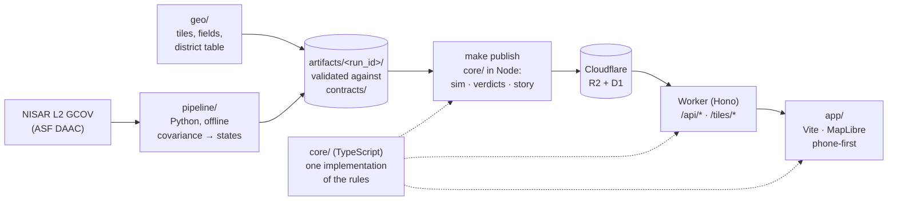

<div align="center">

# Mudskipper

**Proof, not paperwork.**

*Was this rice field really drained?*

Mudskipper uses NASA-ISRO NISAR radar to show, field by field, what space can prove about rice-field
drainage, what it can't, and where an inspector should look first.


[](https://github.com/volkthienpreecha/Mudskipper/actions/workflows/contracts.yml)

`nisar` · `sar` · `l-band` · `polarimetry` · `rice` · `alternate-wetting-and-drying` · `direct-seeded-rice` ·
`punjab` · `cloudflare-workers` · `maplibre` · `open-data`

</div>

---

## Why

Punjab now pays farmers to use less water. Carbon credits reward **alternate wetting and drying (AWD)**, and a
state subsidy of Rs 1,500 per acre rewards **direct-seeded rice (DSR)**: 31,478 farmers and more than 4 lakh
acres in Kharif 2026 (*ASSUMED*, [DT Next/PTI](https://www.dtnext.in/news/business/punjab-dsr-area-rises-36-to-over-4-lakh-acres-in-kharif-2026-minister)).
Today someone checks those fields on foot. Monsoon cloud blinds optical satellites; L-band radar sees through
cloud and the crop canopy. Standing water and drained mud also scatter radar very differently.

Mudskipper labels each field **flooded**, **drained** or **uncertain** on every NISAR pass. It gives a season
verdict, *consistent with AWD*, *not consistent with AWD* or *not enough evidence*, plus a DSR signal. It then
measures how much a 12-day revisit can and cannot verify, and ranks fields for inspection. Every number on
screen says whether it was **OBSERVED** by the radar, **INFERRED** by our model, or **ASSUMED** from a cited
source.

**Live:** [mudskipper-nisar.pages.dev](https://mudskipper-nisar.pages.dev) ·
API: [`/api`](https://mudskipper-nisar.pages.dev/api) · [`/api/story`](https://mudskipper-nisar.pages.dev/api/story) ·
[`/api/states`](https://mudskipper-nisar.pages.dev/api/states) · [`/api/detectability`](https://mudskipper-nisar.pages.dev/api/detectability)

> **Status:** the contract, core rules, field geometry and the Cloudflare API are live. The site currently serves
> the **SAMPLE** fixture run (every response says `"fixture": true`) behind a placeholder page; the real NISAR run
> replaces it when the radar pipeline's files are published, and the full app replaces the placeholder when it
> lands.

## How it works



1. **Radar to states** (`pipeline/`). Bounded reads of each tile from NISAR GCOV. HH/HV backscatter (and
   Freeman–Durden surface, double-bounce and volume power on quad-pol passes) is averaged per field in linear
   power. A per-stage two-component mixture gives `p_flooded`, and an honest *uncertain* band covers anything
   the radar can't call.
2. **States to verdicts** (`core/`). A seeded simulation asks what these exact pass dates could catch: how
   often a field truly practicing AWD would show up drained, and how often a continuously flooded field would
   be falsely flagged. The verdict rule uses only those two numbers, so the tool measures its own blind spots.
3. **Verdicts to inspections** (`core/rank`). 80% of an inspection budget goes by evidence × area. The other
   20% are seeded random checks stratified by district, so nobody can game the ranking.
   *Ranking for inspection, not a finding about anyone.*
4. **Serve** (`platform/`). One Cloudflare Worker serves the app, a typed JSON API and Range-capable map
   tiles from R2.

The rules are written down exactly in [`contracts/CONTRACTS.md`](contracts/CONTRACTS.md), down to the random
number generator, so the Python reference and the TypeScript core agree to the bit.

## Repository

| Path | What | Owner |
|---|---|---|
| [`docs/`](docs) | [Build spec](docs/SPEC.md), [win guide](docs/WIN_GUIDE.md), generated page copy | team |
| [`contracts/`](contracts) | The contract: [CONTRACTS.md](contracts/CONTRACTS.md), JSON Schemas, reference rules, fixtures, validator | shared |
| [`pipeline/`](pipeline) | NISAR search, bounded reads, decomposition, per-field states, overlays, checks | Ishaan |
| [`geo/`](geo) | Tiles, field polygons, district table, sample claims | Karthik |
| [`core/`](core) | TypeScript: simulation, verdicts, ranking, story, typed API client | Karthik |
| [`platform/`](platform) | Cloudflare Worker, D1 migrations, publish script, CI | Karthik |
| [`app/`](app) | The site: story, map, field card, Detectability Lab, Scarecrow, evidence, judges | Volk |
| [`DECISIONS.md`](DECISIONS.md) | Every decision, with its reason | team |

## Run it on fixtures

Needs Python ≥ 3.12 and `make`.

```sh
make setup            # .venv with jsonschema, the validator's only dependency
make check            # contract tests + validate fixtures + fixtures match a fresh build
make fixtures         # regenerate contracts/fixtures (stdlib only, seeded, deterministic)
make validate         # validate fixtures and every artifacts/<run_id>/ (acceptance test T1)
make help             # everything else
```

`contracts/fixtures/` holds a complete sample run: 2 tiles, 300 fields, 12 passes (none in the NISAR data
gap), all three verdicts, overlays, histograms, 60 synthetic claims, and one response per API endpoint. Every
file says `"fixture": true`, and every granule id starts with `SAMPLE_`.

## Moving run data between teammates

Run folders (`artifacts/<run_id>/`) never go into git. Share and fetch them as GitHub Release assets, with a
SHA-256 manifest checked on the way in (macOS, Linux or Windows; needs Python and the GitHub CLI):

```sh
python platform/scripts/run_transfer.py share r01v1        # pipeline: upload artifacts/r01v1
python platform/scripts/run_transfer.py fetch r01v1        # platform: download it, verified
python platform/scripts/run_transfer.py fetch geo-pipeline-tiles --dir artifacts/r01   # geo's fields for the pipeline's tiles
python platform/scripts/run_transfer.py list
make publish RUN_ID=r01v1                                  # compute, validate, deploy (platform/README.md)
```

Shared now: `geo-r01`, the official study tiles (the pipeline's, 2,329 FTW fields; DECISIONS K-117), and `geo-rice-dense`, the rice-dense alternative (4,599 FTW fields). `geo-pipeline-tiles` is the same as `geo-r01`.

## For judges

| Criterion | What we show |
|---|---|
| Impact | Rs 61 crore DSR subsidy checked by hand; rice methane credits contracted in 2026; groundwater + methane; four named user groups |
| Creativity | A tool that measures its own blind spots and turns them into an inspection plan |
| Validity | Peer-reviewed physics; reference-checked decomposition; district table; NASA OPERA cross-check; Limits box; no invented accuracy |
| Relevance | NISAR GCOV at the core; polarizations; time series; human driver on natural resources; NASA-ISRO partnership |
| Presentation | Hero animation, 45-second tour, phone-first, three evidence tags |

*Deep links into the live site are added to this table when it deploys.*

## Limits

> No 2026 ground truth in Punjab yet. NISAR revisits every 12 days and has a data gap from Jul 27 to Aug 10,
> 2026. Data are provisional. States are inferred without labels. DSR is a signal, not proof. We show
> irrigation evidence, not emissions.

## Team

**Volk** (app, design, video) · **Karthik** (platform, core, geo) · **Ishaan** (radar pipeline, methods)

## Data, credits and AI use

- **NASA data:** NISAR L2 GCOV (NASA-ISRO), provisional, via the [Alaska Satellite Facility](https://nisar-docs.asf.alaska.edu/).
  OPERA DSWx if the cross-check runs.
- **Other data:** Sentinel-2 via [Fields of The World](https://github.com/fieldsoftheworld/ftw-baselines);
  Han et al. 2022 paddy rice map; Punjab Department of Agriculture DSR figures.
- **Science we build on:** Islam et al. 2026 (L-band full-pol AWD monitoring); Jin et al. 2026 (drainage
  duration and PALSAR-2 sensitivity); Shah et al., AAAI 2026, and Microsoft's
  [rice-irrigation-mapping-s1s2](https://github.com/microsoft/rice-irrigation-mapping-s1s2) (Sentinel-1 AWD/DSR
  in Punjab). Full list in [`NOTICE`](NOTICE) and [`DECISIONS.md`](DECISIONS.md).
- **AI use:** Claude Code assisted with code and drafting. Every number comes from code run on the listed
  data. No AI-generated images.

## License

[GPL-3.0-only](LICENSE), because the pipeline builds on pyNISAR and polsartools (GPL-3.0). Third-party
notices are in [`NOTICE`](NOTICE). No NASA or ISRO logos are used; all artwork is original.
